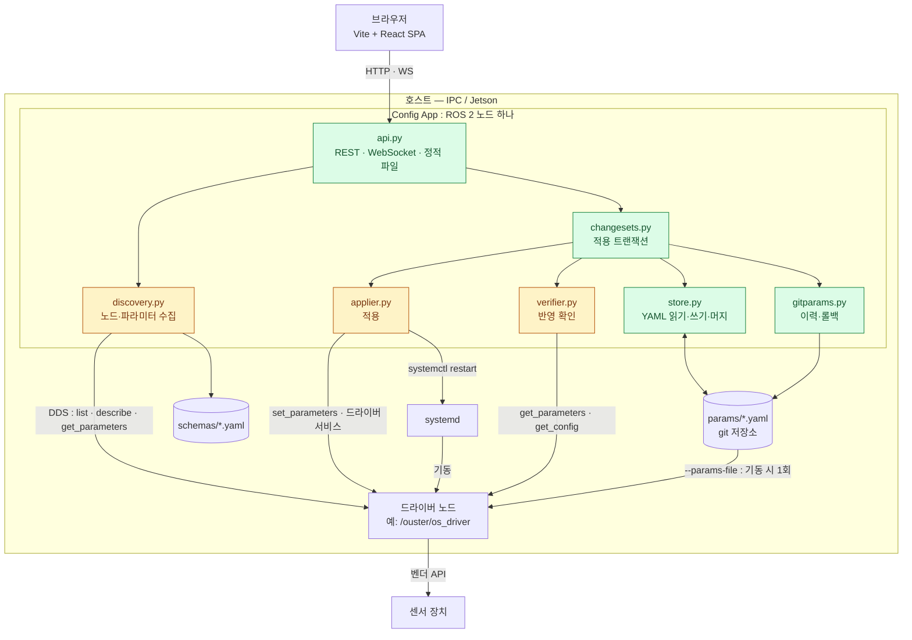
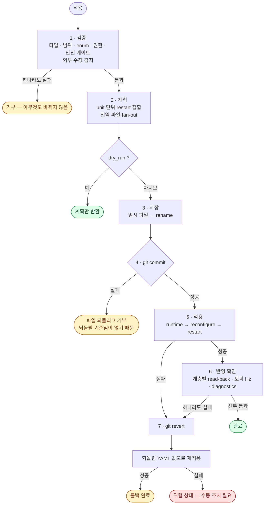
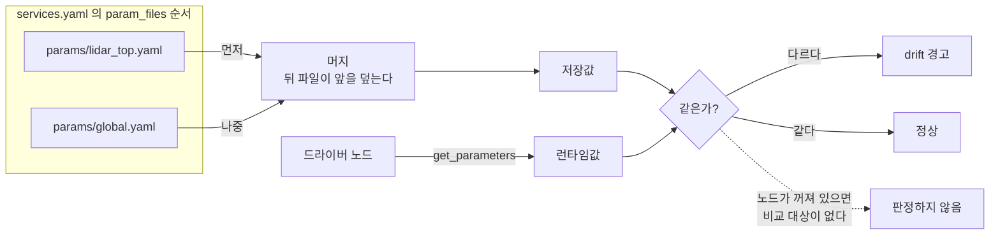
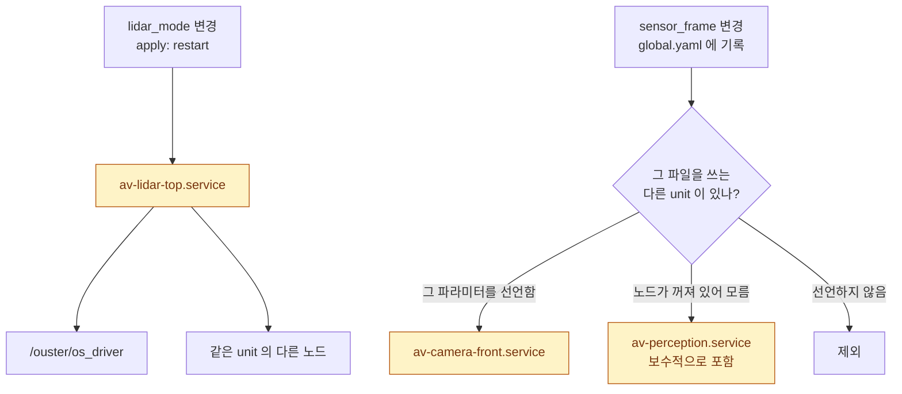
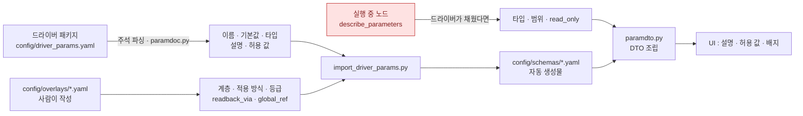
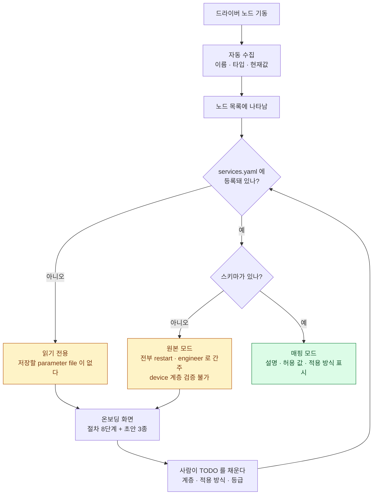
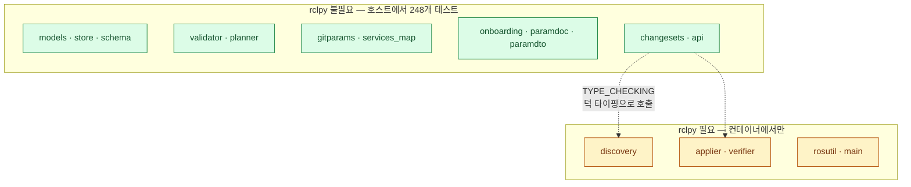

# 동작 구조

구현된 것을 기준으로 그렸다. 설계 의도는 [web-configure-app-spec.md](web-configure-app-spec.md) 를 본다.

## 1. 전체 구성

초록은 호스트에서 테스트까지 끝낸 모듈, 노랑은 rclpy 가 필요해 **아직 실환경에서
돌려보지 못한** 모듈이다.

설정은 위에서 아래로만 흐른다. Config App 은 YAML 을 쓰고 드라이버에 적용을
요청하며, 센서 장치에 쓰는 것은 드라이버뿐이다.

## 2. 적용 트랜잭션

적용 버튼 하나가 검증 → 저장 → 적용 → 확인 → (실패 시) 롤백을 한 번에 수행한다.

롤백은 `reset` 이 아니라 **revert commit** 을 쌓는다. 실패한 시도도 이력에 남아야
감사 로그가 성립한다. 재적용에 쓰는 값은 요청값이 아니라 **되돌린 YAML 의 값**이다.
요청값을 다시 쓰면 YAML 은 되돌아갔는데 장치에는 새 값이 남는다.

## 3. 저장값은 어떻게 정해지고 drift 는 무엇인가

저장값은 **단일 파일의 값이 아니다.** `global.yaml` 이 뒤에 오므로 전역 값이
노드별 값을 덮는다. 쓸 때도 같은 규칙을 따른다 — 그 파라미터가 **이기고 있는
파일**에 써야 실제로 반영된다.

## 4. restart 영향 범위는 unit 단위다

재시작 수단이 `systemctl restart <unit>` 이고 unit 하나가 노드 여러 개를 띄우므로,
노드 단위로 묶으면 실제 중단 범위를 과소평가한다. 전역 파일을 고치면 그 파일을
쓰는 unit 들로 번지되, 그 파라미터를 **실제로 선언한** 노드가 있는 unit 만 고른다.

## 5. 스키마는 어디서 오는가

`describe_parameters` 가 빨간 이유는 **상당수 드라이버가 `ParameterDescriptor` 를
채우지 않기 때문**이다. ouster-ros 는 `declare_parameter` 를 99회 호출하면서
기술자를 0회 쓴다. 그래서 설명과 허용 값은 드라이버가 배포하는 parameter file 의
주석에서만 얻을 수 있다.

## 6. 신규 센서가 장착되면

조회는 등록 없이도 자동이다. **변경만 등록이 필요하다.** 어느 systemd 유닛이 그
노드를 띄웠는지는 ROS 그래프로 알 수 없기 때문이다.

## 7. ROS 의존을 분리한 이유

오케스트레이터(`changesets.py`)와 라우터(`api.py`)가 ROS 의존 모듈을
`TYPE_CHECKING` 으로만 참조한다. 덕분에 **트랜잭션 로직과 REST 표면 전체를
컨테이너 없이 테스트**할 수 있다. 이 분리가 없었다면 롤백 경로를 한 번도 검증하지
못했을 것이다.
